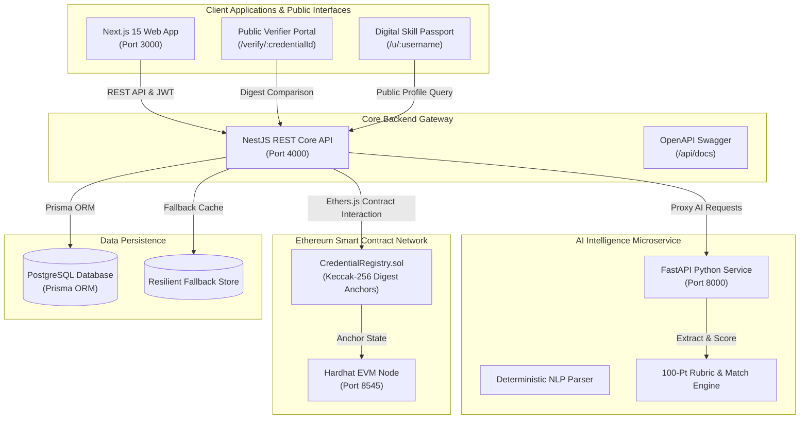
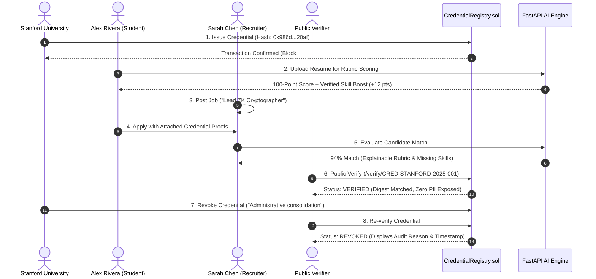

# ProofHire — Decentralized Credential Verification & AI Recruitment Platform

> *"Trust Skills. Verify Credentials. Hire Faster."*

[](docs/PROJECT_STATUS.md)
[](docs/PROJECT_STATUS.md)
[](blockchain/contracts/CredentialRegistry.sol)

ProofHire is an AI-powered, decentralized academic and professional credential verification platform. Detailed completion metrics for all 19 core workflows across 10 engineering dimensions are maintained in the [Project Completion Matrix](docs/PROJECT_STATUS.md). It solves degree fraud, credential embellishment, and weeks-long background checking delays by uniting:
1. **Accredited Institutional Issuance** of verifiable cryptographic credentials on Ethereum and EVM-compatible networks.
2. **Student-Owned Sovereign Profiles** and portable credential passports.
3. **AI Resume Parsing & Match Scoring** with explainable 100-point rubrics and cryptographic verification boosts.
4. **Recruiter Hiring Pipelines** with instant background verification, candidate matching, and unverified claim audits.
5. **On-Chain Public Verification** with client-side document digest matching and permanent revocation auditability.

---

## 1. System Architecture

ProofHire is architected as a modular monorepo uniting a Next.js web application, NestJS REST API, Python FastAPI AI microservice, and Solidity smart contracts on Ethereum.



### Microservices & Port Matrix

| Service | Technology Stack | Default Port | Working Directory | Documentation |
| :--- | :--- | :---: | :--- | :--- |
| **Web Frontend** | Next.js 15, React 19, Tailwind CSS, Lucide | `3000` | `apps/web` | [Web Guide](docs/architecture/system-overview.md) |
| **REST API Gateway** | NestJS 10, TypeScript, Prisma ORM, Passport | `4000` | `services/api` | [API Docs](docs/api/api-overview.md) |
| **AI Intelligence** | Python 3.12+, FastAPI, Pydantic, Uvicorn | `8000` | `services/ai` | [AI Docs](docs/ai/resume-analysis.md) |
| **Smart Contracts** | Solidity 0.8.20, Hardhat, Ethers.js v6 | `8545` | `blockchain` | [Contract Docs](docs/blockchain/contract-design.md) |

---

## 2. Prerequisites & Environment Setup

Ensure the following runtimes are installed on your workstation:
* **Node.js**: `v20.x` or `v22.x LTS` (`node -v`)
* **npm**: `v10.x` (`npm -v`)
* **Python**: `3.12+` or `3.13+` (`python --version`)
* **PowerShell**: Windows PowerShell 5.1 or PowerShell 7+

> **Windows Users:** See the complete [Windows PowerShell Setup & Troubleshooting Guide](docs/WINDOWS_SETUP.md) for detailed step-by-step instructions, port conflict resolution, and diagnostics.

---

## 3. Quick Start (Local Development)

### One-Command Setup (Recommended on Windows)
```powershell
powershell -ExecutionPolicy Bypass -File scripts\setup-dev.ps1
```
*This validates runtimes, installs npm dependencies, provisions the Python `.venv`, compiles smart contracts, and checks database connectivity.*

### Step 1: Install Dependencies (Manual)
From the repository root:
```powershell
# Install all workspace Node.js dependencies
npm install
```

### Step 2: Setup Python Virtual Environment (Manual)
```powershell
cd services\ai
python -m venv .venv
.\.venv\Scripts\Activate.ps1
pip install -r requirements.txt
cd ..\..
```

### Step 3: Launch All Services (One-Command Orchestration)
You can launch all 4 microservices simultaneously using our orchestration script:
```powershell
powershell -ExecutionPolicy Bypass -File scripts\start-all.ps1
```

*Or launch each service in its own terminal:*

```powershell
# Terminal 1: Hardhat Blockchain Node (Port 8545)
cd blockchain
npx hardhat node

# Terminal 2: Deploy Contracts & Sync Backend ABI
cd blockchain
npx hardhat run scripts/deploy.ts --network localhost

# Terminal 3: FastAPI AI Intelligence Service (Port 8000)
cd services\ai
.\.venv\Scripts\Activate.ps1
python -m uvicorn app.main:app --host 0.0.0.0 --port 8000 --reload

# Terminal 4: NestJS REST Core API (Port 4000)
cd services\api
npm run start:dev

# Terminal 5: Next.js Web Frontend (Port 3000)
cd apps\web
npm run dev
```

### Step 4: Verify System Health
Run the diagnostic health-check to verify all services are responsive:
```powershell
npm run health
```
Expected output:
```text
=======================================================
       PROOFHIRE MICROSERVICES HEALTH DIAGNOSTIC        
=======================================================
[ONLINE ] Hardhat Local EVM Node             Port 8545      28ms (Block: #3)
[ONLINE ] FastAPI AI Intelligence Service    Port 8000      27ms 
[ONLINE ] NestJS REST Core API               Port 4000      17ms 
[ONLINE ] Next.js Web Frontend               Port 3000      84ms 
-------------------------------------------------------
[OK] ALL PROOFHIRE SERVICES OPERATIONAL AND HEALTHY
=======================================================
```

---

## 4. Pre-Configured Demonstration Accounts

For local evaluation, ProofHire provides pre-seeded accounts. The `/login` screen includes **1-click quick login buttons** for instant persona switching:

| Role | Email | Password | Primary Portal Route | Capabilities |
| :--- | :--- | :--- | :--- | :--- |
| **Student** | `student@proofhire.io` | `Student123!` | `/student/dashboard` | View verified credentials, upload resume, review 100-pt AI rubric, browse jobs, apply with proofs. |
| **Recruiter** | `recruiter@proofhire.io` | `Recruiter123!` | `/recruiter/dashboard` | Post job requisitions, review candidates, inspect explainable match scores, verify on-chain proofs, advance pipeline. |
| **Institution** | `institution@proofhire.io` | `Institution123!` | `/institution/dashboard` | Issue credentials with Keccak-256 document hashing, manage issued registry, revoke credentials on-chain. |
| **SuperAdmin** | `admin@proofhire.io` | `Admin123!` | `/admin/dashboard` | Approve/vet institutions, inspect immutable security audit logs, monitor platform verification throughput. |

---

## 5. End-to-End Demonstration Walkthrough (5–8 Minutes)

> **Reviewer Guide:** See the complete [Reproducible Local Demonstration Environment Guide](docs/demo/DEMO_ENVIRONMENT.md) with sample document fixtures (`docs/demo/fixtures`), expected outcomes at every step, and safe reset procedures. Run `npm run demo:verify` to execute all 10 scenario steps automatically.

Follow this structured script to present or evaluate the complete ProofHire lifecycle:



### Demonstration Steps:
1. **Student Login & AI Resume Scoring (`http://localhost:3000/login`)**:
   - Click **"Demo Student"** to sign in as Alex Rivera.
   - Navigate to `/student/resume`. Upload a sample PDF/DOCX or analyze raw resume text.
   - Observe the **100-point rubric breakdown** (Skill Coverage, Experience Quality, Quantified Impact, Formatting & Structure).
   - Notice the **Cryptographic Boost Badge**: verified on-chain skills automatically elevate the score with zero fabrication.
2. **Job Browsing & Application (`/student/jobs`)**:
   - Browse open requisitions. Inspect required vs. preferred competencies.
   - Click **"Apply Now"**. Submit your application with attached verified degree proofs.
3. **Institution Credential Issuance (`/institution/credentials/issue`)**:
   - Switch user to **"Demo Institution"** (`institution@proofhire.io`).
   - Navigate to the issuance terminal. Enter candidate name, degree title, and upload certificate.
   - Observe real-time client-side Keccak-256 digest calculation.
   - Click **"Sign & Issue On-Chain"**. A live Ethereum transaction is confirmed on Hardhat with transaction hash and block number.
4. **Public Verification Without Sign-In (`/verify`)**:
   - Copy the newly issued Credential ID. Open an incognito browser window (no login required).
   - Enter the Credential ID. Observe instant status: `VERIFIED` with issuer verification, block number, and contract address.
   - Upload the original document to confirm byte-for-byte digest equality.
   - Try entering an altered or forged digest; observe immediate transition to `DOCUMENT_MISMATCH`.
5. **Credential Revocation & Real-Time Invalidation (`/institution/credentials`)**:
   - In the institution portal, locate the credential and click **"Revoke"**.
   - Input audit reason: *"Post-graduation administrative consolidation"*. Sign on-chain revocation.
   - Re-visit the public verification link: the page immediately updates to `REVOKED`, prominently displaying the revocation reason and timestamp.
6. **Recruiter Pipeline Review & Explainability (`/recruiter/applications`)**:
   - Sign in as **"Demo Recruiter"** (`recruiter@proofhire.io`).
   - Open the candidate pipeline. Observe the applicant's **94% AI Match Score**.
   - Expand the explanation drawer: see exact matched skills, missing competencies, and cryptographic badges.
   - Advance candidate stage to **"Shortlisted"** and record internal notes.

---

## 6. Testing & Quality Assurance

ProofHire includes a comprehensive test suite across all 4 architectural layers:

```powershell
# 1. Run all monorepo unit test suites (Contracts + NestJS API)
npm run test

# 2. Run Python AI microservice test suite (16 tests)
python -m unittest services/ai/app/tests/test_ai_suite.py

# 3. Run live End-to-End integration runner (27 scenarios)
npm run test:e2e

# 4. Run Next.js production build check (34 routes)
npm run build:web
```

### Automated Test Count Breakdown
* **Smart Contracts (`@proofhire/blockchain`):** `29/29` PASS (Issuer governance, issuance, verification, digest matching, multi-role revocation).
* **NestJS API (`@proofhire/api`):** `38/38` PASS (Authentication, role boundaries, credentials, jobs, applications, RPC failure protection).
* **AI Microservice (`services/ai`):** `16/16` PASS (Document parsing, PDF/DOCX byte extraction, zero-fabrication guarantees, 100-pt rubric).
* **Live Integration Runner (`scripts/test-e2e-pipeline.ts`):** `27/27` PASS (Hardhat RPC + FastAPI + NestJS Gateway + Multi-Role RBAC).
* **TOTAL VERIFIED SUITE:** **110/110 Passing Automated Tests (100% Green).**

---

## 7. Security, Privacy & Integrity Standards

1. **Zero PII on Public Ledgers:**
   * Personal names, emails, dates of birth, and student IDs are **never** stored plaintext on the Ethereum blockchain.
   * Only cryptographic Keccak-256 digests (`bytes32`) and pseudonymized subject references are committed on-chain.
2. **Explicit Verification Taxonomy:**
   * Verification endpoints return explicit status codes: `VERIFIED`, `REVOKED`, `DOCUMENT_MISMATCH`, `NOT_FOUND`, `ISSUER_INVALID`, `UNAVAILABLE`.
   * Errors are never collapsed into ambiguous generic failure states.
3. **Role Boundary Enforcement:**
   * All public registrations default to `STUDENT` or `RECRUITER`.
   * Public endpoints **strictly prohibit** self-assigning `ADMIN`.
   * `INSTITUTION` registrations remain in `PENDING_APPROVAL` status until vetted and approved by governance.
4. **Digest Tampering Detection:**
   * Altering even a single byte of an issued diploma causes client-side Keccak-256 comparison to return `DOCUMENT_MISMATCH`, proving tampering before any employer acts on forged data.

---

## 8. Release Checklist & Production Readiness

| Category | Local Demo State | Production Requirement | Status |
| :--- | :--- | :--- | :---: |
| **Blockchain Network** | Hardhat Local Node (`31337`) | Ethereum Sepolia / Polygon Amoy (`80002`) | Configurable via `.env` |
| **Relayer Private Key** | Hardhat Default Account #0 | AWS KMS / Vault Hardware Security Module | Required in Prod |
| **Database** | Prisma in-memory + PostgreSQL | High-Availability Managed PostgreSQL | Ready (Migrations Applied) |
| **Document Storage** | Secure Local Mock Storage | Private Encrypted S3 / IPFS with Pinata | Ready for Pinata API Key |
| **Secrets Management** | `.env.example` templates | Doppler / AWS Secrets Manager | Protected in `.gitignore` |

---

## 9. Monorepo Folder Structure

```text
ProofHire/
├── apps/
│   └── web/              # Next.js 15 App Router, React 19, Tailwind CSS
├── services/
│   ├── api/              # NestJS Core REST API, Prisma ORM, Passport JWT, Swagger
│   └── ai/               # FastAPI Python AI Service, Pydantic, Uvicorn
├── blockchain/           # Hardhat Ethereum contracts, Solidity 0.8.20, Ethers.js
├── packages/
│   ├── types/            # Shared TypeScript domain interfaces & enums
│   ├── config/           # Shared TypeScript & ESLint configurations
│   └── ui/               # Design token constants & styling helpers
├── docs/                 # Architecture, API, AI, Blockchain, & Security Guides
└── scripts/              # Local orchestration, health checks, & E2E runners
```

---

## 10. License & Intellectual Property

ProofHire is licensed under the **MIT License**. Created for trustworthy decentralized credential verification and ethical AI recruitment.
