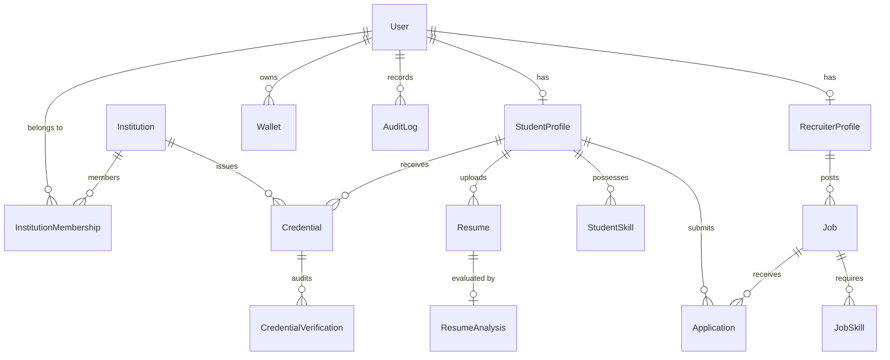

# ProofHire — Database Design & Prisma Schema

## Entity Relationship Overview

The ProofHire PostgreSQL schema is modeled and managed via Prisma ORM (`services/api/prisma/schema.prisma`).

---

## Core Entities

1. **User:** Central identity table containing email, password hash, role (`STUDENT`, `RECRUITER`, `INSTITUTION`, `ADMIN`), and account status (`ACTIVE`, `PENDING_APPROVAL`, `SUSPENDED`).
2. **StudentProfile:** Extends User for candidates with academic affiliation, bio, graduation cohort, GPA, and portfolio links.
3. **RecruiterProfile:** Extends User for corporate recruiters with company credentials and verification status.
4. **Institution:** Accredited university or certification body with registration code, verification timestamp, and issuer wallet address.
5. **Credential:** The primary verifiable credential record holding public hash ID, recipient ID, issuing institution ID, IPFS hash, transaction hash, block number, certified skills, and revocation status.
6. **CredentialVerification:** Audit trail of all verification queries (public web, recruiter, or API).
7. **Job & Application:** Requisitions and candidate pipeline records with AI match scores and match rationales.
8. **AuditLog:** Security audit records capturing IP address, actor, action, and target entity.
