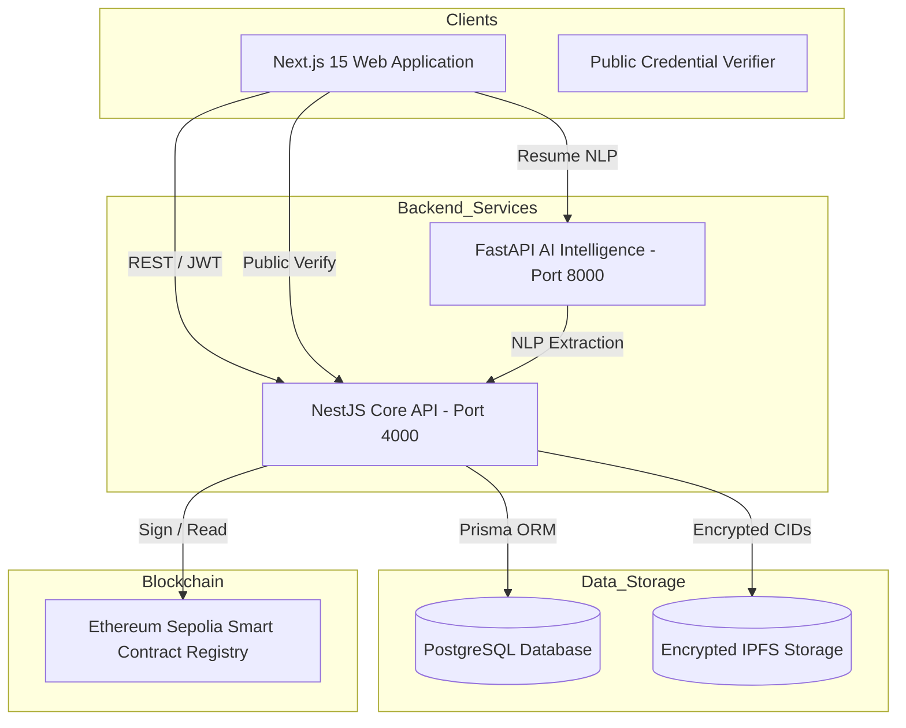

# ProofHire — System Overview & Architecture

## Executive Summary

ProofHire is an AI-powered decentralized credential verification and recruitment platform. Its primary objective is to replace the slow, manual, error-prone credential verification process with cryptographic guarantees and automated candidate-to-job matching.

---

## Service Responsibilities

### 1. Web Application (`apps/web`)
- Next.js 15 App Router providing single-page fluid portal navigation for 4 roles: `STUDENT`, `RECRUITER`, `INSTITUTION`, `ADMIN`.
- Server-side route protection and client-side accessible UI primitives.
- Public credential verification routes accessible without authentication.

### 2. NestJS Core API (`services/api`)
- Port 4000 REST API serving auth, credential issuance, job postings, candidate applications, and institutional vetting.
- OpenAPI Swagger documentation available at `/api/docs`.
- Role-based access control guards (`@Roles(UserRole.INSTITUTION)`).

### 3. AI Service (`services/ai`)
- Port 8000 FastAPI service for resume parsing, keyword extraction, and candidate match scoring.
- Incorporates verified credential boost (+20 points) for skills backed by on-chain records.

### 4. Smart Contracts (`blockchain`)
- `ProofHireCredential.sol` Solidity contract deployed on Ethereum Sepolia.
- Manages authorized university issuer registries, credential hashes, and revocation status.
