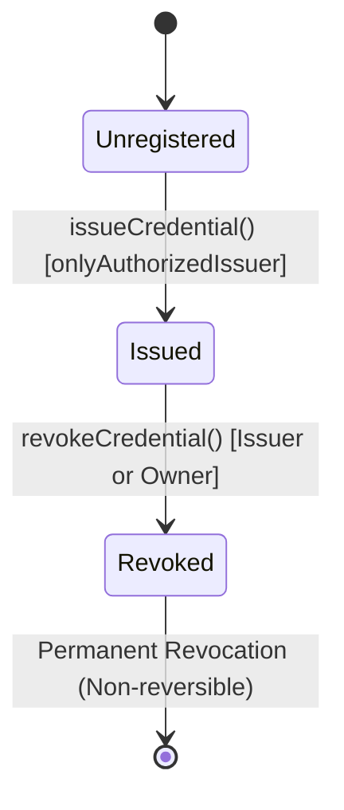

# Credential Registry Smart Contract Architecture

## 1. Overview & Objectives

The `CredentialRegistry.sol` smart contract provides an immutable, decentralized anchor for educational degrees, vocational diplomas, and institutional certifications on EVM-compatible blockchains (Ethereum, Polygon, Polygon Amoy testnet). 

It enforces:
1. **Accredited Issuer Governance**: Only verified academic institutions authorized by the platform owner can register credentials.
2. **Privacy-Preserving Anchoring**: Zero Personally Identifiable Information (PII) such as student names, GPAs, or resumes are stored on-chain.
3. **Cryptographic Integrity**: Document integrity is guaranteed by anchoring canonical Keccak-256 digests (`bytes32`).
4. **Transparent Revocation Auditing**: Credential revocation records are permanent and auditable; historical events are never deleted or overwritten.

---

## 2. Data Structures

### `IssuerInfo`
```solidity
struct IssuerInfo {
    bool isAuthorized;
    bool isSuspended;
    string name;
    string metadataURI; // IPFS CID or institutional URL
    uint256 authorizedAt;
    uint256 revokedAt;
}
```

### `CredentialRecord`
```solidity
struct CredentialRecord {
    string credentialId;       // e.g. "CRED-MIT-2024-001"
    address issuer;            // Authorized institution wallet
    bytes32 studentReference;  // Salted Keccak-256 hash: keccak256(abi.encodePacked(studentAddress, credentialId, salt))
    bytes32 documentDigest;    // Keccak-256 or SHA-256 hash of original PDF certificate
    uint256 issuanceTimestamp; // Block timestamp of issuance
    bool isRevoked;            // Revocation state flag
    uint256 revocationTimestamp; // Timestamp if revoked
    string revocationReason;   // Documented reason for revocation
}
```

---

## 3. Privacy-Conscious Subject Referencing

To prevent identity correlation, dictionary attacks, and tracking across institutions, the contract does **not** store plaintext student wallet addresses or raw personal data.

Instead, the `studentReference` field is computed using a salted cryptographic commitment:
$$\text{studentReference} = \text{Keccak256}(\text{studentAddress} \mathbin{\Vert} \text{credentialId} \mathbin{\Vert} \text{privacySalt})$$

- Even if an attacker knows a student's public address, they cannot query all credentials issued to that student on a public block explorer without the salt.
- The student can selectively reveal their credentials by providing the salt to employers or verifiers.

---

## 4. Authorization & Governance Model

The contract employs a strict role-based access model:

| Role | Permitted Actions | Prohibited Actions |
| :--- | :--- | :--- |
| **Contract Owner (Governance)** | Authorize issuers, suspend issuers, revoke rogue issuers, revoke credentials in disputed emergencies. | Cannot issue credentials on behalf of universities. |
| **Authorized Issuer (Institution)** | Issue credentials under their institutional identity, revoke credentials they previously issued. | Cannot authorize other institutions; cannot revoke credentials issued by peer institutions. |
| **Public / Verifier / Recruiter** | Query `verifyCredential()` and inspect emission events. | Cannot issue, modify, or revoke any record. |

### Access Control Rules:
- `onlyAuthorizedIssuer`: Reverts if `msg.sender` is not authorized or is currently suspended.
- `onlyOwner`: OpenZeppelin `Ownable` guard for administrative actions.

---

## 5. State Machine & Lifecycle



1. **Issuance**:
   - Requires non-empty `credentialId` and non-zero `documentDigest`.
   - Prevents duplicate `credentialId` collision (`require(!credentials[id].issuanceTimestamp > 0)`).
   - Records block timestamp and emits `CredentialIssued`.
2. **Revocation**:
   - Can only be invoked by the issuing institution or contract owner.
   - Requires reason string.
   - Sets `isRevoked = true` and `revocationTimestamp = block.timestamp`.
   - Emits `CredentialRevoked`.
   - Cannot be re-issued or "un-revoked".

---

## 6. Events Emission Specification

```solidity
event IssuerAuthorized(address indexed issuer, string name, uint256 timestamp);
event IssuerSuspended(address indexed issuer, uint256 timestamp);
event IssuerRevoked(address indexed issuer, uint256 timestamp);
event CredentialIssued(string indexed credentialId, address indexed issuer, bytes32 indexed studentReference, bytes32 documentDigest, uint256 issuanceTimestamp);
event CredentialRevoked(string indexed credentialId, address indexed revoker, uint256 timestamp, string reason);
```

All indexing enables efficient query filters via Ethers.js or Graph indexers without exposing private metadata.
