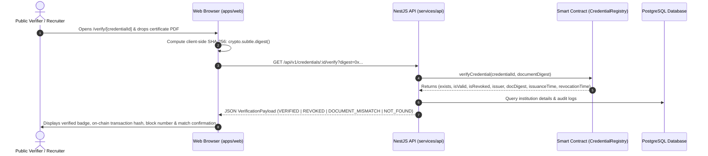

# End-to-End Cryptographic Verification Architecture

## 1. Trust Architecture & Verification Model

ProofHire's verification system eliminates "fake blockchain truth" by ensuring that:
1. PostgreSQL stores convenience metadata and indexing for fast querying.
2. The **smart contract** (`CredentialRegistry.sol`) on the Ethereum/Polygon EVM is the sole authoritative anchor for document digests and revocation states.
3. The **verifier's browser or API client** can independently recompute the SHA-256 or Keccak-256 hash of the physical PDF certificate and assert mathematical equality with the on-chain digest.

---

## 2. Verification Protocol Sequence

---

## 3. Explicit Verification Status Definitions

Verification responses must never collapse distinct failure modes into an ambiguous "Invalid" error:

| Status Code | Meaning | User Guidance |
| :--- | :--- | :--- |
| `VERIFIED` | Credential exists on-chain, issuer is authorized, revocation flag is `false`, and document digest matches. | Authentic credential. Suitable for hiring decisions. |
| `REVOKED` | Credential was once validly issued but has been formally revoked by the institution or governance. | Non-authentic. Revocation reason and timestamp are displayed. |
| `DOCUMENT_MISMATCH` | Credential ID exists on-chain, but the uploaded document's cryptographic hash does not match the registered digest. | High alert: The PDF or certificate has been altered or tampered with after issuance. |
| `NOT_FOUND` | No record exists on-chain for the supplied credential ID. | The identifier was mistyped or never issued. |
| `ISSUER_INVALID` | Credential exists, but the issuing institution's authorization has been suspended or revoked. | Credential authenticity is questionable pending institutional review. |
| `UNAVAILABLE` | RPC provider or blockchain node cannot be reached. | Fallback state. System explicitly warns user that on-chain proof could not be verified. |

---

## 4. Canonical Document Digest Generation

To guarantee independent verifiability:
1. Certificates are exported in PDF/A format.
2. The entire byte stream of the original PDF document is digested:
   - Client-side: `const hashBuffer = await crypto.subtle.digest("SHA-256", fileBytes);`
   - Node.js backend: `crypto.createHash("sha256").update(fileBuffer).digest("hex");`
   - Solidity: `bytes32 documentDigest = bytes32(uint256(sha256(bytes)));` or direct `keccak256` digest format.
3. Because the raw file digest is stored on-chain, neither ProofHire nor any intermediary can alter a single letter of the certificate without invalidating the cryptographic equality check.
